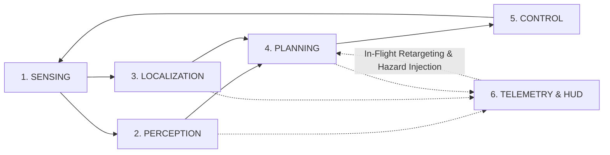

# 🏗️ System Architecture Flowchart: Vision-Based Autonomous UGV

This document provides a complete visual and structural architecture breakdown of the autonomous Unmanned Ground Vehicle (UGV). It shows how sensor streams flow through computer vision perception, GPS-denied sensor fusion, any-angle global planning, local collision avoidance, motor actuation, and real-time mission control.

---

## 🗺️ 1. End-to-End System Architecture Flowchart

```mermaid
flowchart TD
    %% Styling Classes
    classDef sensorLayer fill:#1e293b,stroke:#38bdf8,stroke-width:2px,color:#f8fafc;
    classDef perceptLayer fill:#1e1b4b,stroke:#818cf8,stroke-width:2px,color:#f8fafc;
    classDef stateLayer fill:#064e3b,stroke:#34d399,stroke-width:2px,color:#f8fafc;
    classDef planLayer fill:#451a03,stroke:#fb923c,stroke-width:2px,color:#f8fafc;
    classDef ctrlLayer fill:#701a75,stroke:#e879f9,stroke-width:2px,color:#f8fafc;
    classDef dashLayer fill:#0f172a,stroke:#06b6d4,stroke-width:2px,color:#f8fafc;
    classDef simLayer fill:#18181b,stroke:#94a3b8,stroke-width:2px,color:#f8fafc;

    %% ==========================================
    %% LAYER 1: SENSORS & PHYSICAL SIMULATION
    %% ==========================================
    subgraph SENSORS ["📡 LAYER 1: SENSORS & HARDWARE INTERFACE (Webots R2025a)"]
        S_RGB["Front RGB Camera (640x480, 70° FOV, -12° Pitch)"]:::sensorLayer
        S_DEPTH["Front RangeFinder Depth Camera (0.1m - 12m)"]:::sensorLayer
        S_FLANK["Flank Cameras (Left +45°, Right -45°, Rear 180°)"]:::sensorLayer
        S_IMU["3-Axis IMU (Gyroscope & Accelerometer @ 100Hz)"]:::sensorLayer
        S_ENCODERS["Optical Wheel Encoders (Left & Right @ 100Hz)"]:::sensorLayer
        S_SUP_GT["Supervisor Ground Truth Auditor (RMSE Audit Only - No GPS to UGV)"]:::simLayer
    end

    %% ==========================================
    %% LAYER 2: PERCEPTION & COMPUTER VISION
    %% ==========================================
    subgraph PERCEPTION ["👁️ LAYER 2: PERCEPTION & COMPUTER VISION STACK"]
        P_PCL["Pinhole Back-Projection: Depth -> 3D Metric Point Cloud (X, Y, Z)"]:::perceptLayer
        P_YOLO["YOLO 3D Object Detection: Rock, Tree, Hazard Barrel, Goal Beacon"]:::perceptLayer
        P_MIDAS["MiDaS Monocular Depth: Relative Inverse Depth & Turbo/Inferno Colormap"]:::perceptLayer
        P_TERRAIN["HSV + Surface Normal Terrain Classifier (Dirt Road: 0.0 vs Grass: 25.0)"]:::perceptLayer
        P_CLUST["3D Obstacle Spatial Clustering: Height Gating (0.08m-1.8m) & Lateral Offset (Y)"]:::perceptLayer
        P_COSTMAP["2D Rolling Traversability Costmap (6m x 6m, Circular Gaussian Inflation)"]:::perceptLayer
    end

    %% ==========================================
    %% LAYER 3: STATE ESTIMATION (GPS-DENIED)
    %% ==========================================
    subgraph LOCALIZATION ["🧭 LAYER 3: GPS-DENIED LOCALIZATION & SENSOR FUSION"]
        L_ODOM["Differential Wheel Odometry: Δs & Δθ Kinematic Integration @ 100Hz"]:::stateLayer
        L_IMU["IMU Filter: Bias-Corrected Gyro Integration & Yaw Unwrapping @ 100Hz"]:::stateLayer
        L_VO["Visual Odometry: FAST/ORB Feature Tracking & Optical Flow Displacement"]:::stateLayer
        L_EKF["Multi-Rate Extended Kalman Filter (EKF): Fuses Odometry + IMU + VO -> Pose [x, y, θ, v, ω]"]:::stateLayer
    end

    %% ==========================================
    %% LAYER 4: PLANNING & GUIDANCE
    %% ==========================================
    subgraph PLANNING ["🗺️ LAYER 4: NAVIGATION, PATH PLANNING & RECOVERY"]
        PL_THETA["Theta* Any-Angle Global Planner: Line-of-Sight Euclidean Raycast (< 5ms)"]:::planLayer
        PL_CORRIDOR["Road Corridor Cost Model: Dirt Road = 0.0, Off-Road Grass = 25.0"]:::planLayer
        PL_SPLINE["Catmull-Rom Cubic Spline Interpolation: Continuous-Curvature Trajectory"]:::planLayer
        PL_DWA["Dynamic Window Approach (DWA): Velocity Space (v, ω) Sampling over 2.2s Horizon"]:::planLayer
        PL_REC["Recovery Manager: Stuck Detection, Anti-Oscillation & 3-Stage Unstuck Routines"]:::planLayer
    end

    %% ==========================================
    %% LAYER 5: CONTROL & ACTUATION
    %% ==========================================
    subgraph CONTROL ["⚡ LAYER 5: MOTION CONTROL & MOTOR ACTUATION"]
        C_RAMP["Approach Deceleration Ramp & Multi-Stage Goal Point B Docking"]:::ctrlLayer
        C_DIFF["Differential Drive Kinematic Inversion: [v, ω] -> Wheel Speeds [ω_L, ω_R]"]:::ctrlLayer
        C_MOTORS["Webots Rotational Motor Actuators (Left & Right Wheels)"]:::ctrlLayer
    end

    %% ==========================================
    %% LAYER 6: MISSION CONTROL & HUD
    %% ==========================================
    subgraph DASHBOARD ["🖥️ LAYER 6: MISSION CONTROL & TACTICAL TELEMETRY HUD (Flask + ES6)"]
        D_SERVER["Flask Multithreaded Server: Atomic IPC via live_data.json & control_cmd.json"]:::dashLayer
        D_RADAR["2D Tactical Vector Radar: Auto-Fit Viewport, Compass Tape, 5m-20m Rings, 70° FOV Cone"]:::dashLayer
        D_DISPATCH["Live Waypoint Dispatch: Instant Route Presets (A->B, B->A, Cross Field) & In-Flight Retarget"]:::dashLayer
        D_HAZARD["Tactical Actions: Instant Hazard Barrel Injection (⚠️ LIVE DEMO) & Reset"]:::dashLayer
        D_MULTICAM["Multi-Camera Video Stream: Forward RGB, MiDaS Heatmap, Left, Right & Quad View"]:::dashLayer
        D_LOGS["Real-Time Mission Event Stream & Full Audit Log Modal"]:::dashLayer
    end

    %% ==========================================
    %% DATA FLOW INTERCONNECTIONS
    %% ==========================================

    %% Sensors to Perception & Localization
    S_RGB --> P_PCL
    S_RGB --> P_YOLO
    S_RGB --> P_MIDAS
    S_RGB --> P_TERRAIN
    S_RGB --> L_VO
    S_RGB --> D_MULTICAM

    S_DEPTH --> P_PCL
    S_DEPTH --> P_YOLO
    S_DEPTH --> L_VO

    S_FLANK --> D_MULTICAM

    S_IMU --> L_IMU
    S_ENCODERS --> L_ODOM

    %% Perception Connections
    P_PCL --> P_CLUST
    P_PCL --> P_TERRAIN
    P_CLUST --> P_COSTMAP
    P_TERRAIN --> P_COSTMAP
    P_CLUST --> PL_THETA
    P_YOLO --> PL_THETA

    %% Localization Connections
    L_ODOM --> L_EKF
    L_IMU --> L_EKF
    L_VO --> L_EKF
    L_EKF --> PL_THETA
    L_EKF --> PL_DWA
    L_EKF --> C_RAMP
    L_EKF --> D_SERVER

    %% Ground truth comparison
    S_SUP_GT -.->|RMSE Audit| D_SERVER

    %% Planning Connections
    PL_CORRIDOR --> PL_THETA
    P_COSTMAP --> PL_DWA
    PL_THETA --> PL_SPLINE
    PL_SPLINE --> PL_DWA
    PL_DWA --> C_RAMP
    PL_REC --> PL_DWA

    %% Control Connections
    C_RAMP --> C_DIFF
    C_DIFF --> C_MOTORS
    C_MOTORS --> S_ENCODERS

    %% Dashboard Interactivity
    D_SERVER <-->|JSON Polling @ 10Hz| D_RADAR
    D_SERVER <-->|Event Stream| D_LOGS
    D_DISPATCH -->|Atomic POST /api/set_mission| D_SERVER
    D_HAZARD -->|Atomic POST /api/control| D_SERVER
    D_SERVER -->|control_cmd.json| PL_THETA
    D_SERVER -->|control_cmd.json| S_SUP_GT
```

---

## 🔍 2. Detailed Breakdown of the 6 Architectural Layers

### Layer 1: Sensor & Hardware Layer (Physical Simulation)
* **Execution Rate**: 32ms physics step ($31.25\text{ Hz}$), 100Hz IMU and encoder polling.
* **Onboard Sensors**:
  * **Front RGB-D Camera**: Dual aligned color ($640\times 480$) and depth ($0.1 - 12.0\text{m}$) streams at 70° FOV, tilted $-12^\circ$ to cover the ground corridor from 0.4m to 10m ahead.
  * **Surround Vision**: Left flank ($+45^\circ$), right flank ($-45^\circ$), and rear ($180^\circ$) cameras for 360° threat awareness.
  * **Inertial Measurement Unit (IMU)**: 3-axis gyroscope ($100\text{ Hz}$) and 3-axis accelerometer ($100\text{ Hz}$).
  * **Wheel Optical Encoders**: Incremental angular shaft sensors on left and right drive wheels ($100\text{ Hz}$).
* **Ground Truth Supervisor**:
  * An independent Webots node continuously measures true vehicle position $(X_{gt}, Y_{gt}, \theta_{gt})$ strictly to compute **Root Mean Square Error (RMSE)** for judging evaluation. **No GPS data is ever passed to the UGV.**

---

### Layer 2: Computer Vision & Perception Layer
* **Pinhole Camera Back-Projection (`camera_processor.py`)**:
  Projects 2D image coordinates $(u, v)$ and depth channel $Z$ into metric 3D point cloud coordinates $(X, Y, Z)$ using intrinsic parameters ($f_x = 457.1, f_y = 457.1, c_x = 320.0, c_y = 240.0$):
  $$X = \frac{(u - c_x) Z}{f_x}, \quad Y = \frac{(v - c_y) Z}{f_y}, \quad Z = Z$$
* **YOLO 3D Object Detector (`yolo_detector.py`)**:
  Identifies obstacles (`ROCK`, `TREE`, `HAZARD_BARREL`, `GOAL_BEACON`) with 2D bounding boxes and calculates their 3D centroid and azimuth bearing angle.
* **MiDaS Monocular Relative Depth (`midas_depth_estimator.py`)**:
  Estimates relative inverse depth from 2D color images and produces a colorized Inferno/Turbo depth colormap streamed to the mission HUD.
* **Terrain Traversability Classifier (`terrain_classifier.py`)**:
  Fuses HSV color segmentation with height-gradient surface normal calculations. Assigns **traversability cost 0.0** to flat brown dirt paths and **cost 25.0** to rough green grass.
* **3D Spatial Clustering (`obstacle_detector.py`)**:
  Filters out ground plane points ($Z < 0.08\text{m}$) and canopy points ($Z > 1.8\text{m}$). Discretizes remaining points into spatial clusters with radius, forward distance, and lateral offset ($Y$).
* **Traversability Costmap (`traversability_map.py`)**:
  A 2D robot-centric rolling costmap ($6.0\text{m} \times 6.0\text{m}$) with circular Gaussian inflation buffers ensuring safe vehicle clearance.

---

### Layer 3: Localization & GPS-Denied State Estimation Layer
* **Wheel Odometry Kinematics (`wheel_odometry.py`)**:
  Calculates distance traveled $\Delta s$ and heading change $\Delta \theta$ at 100Hz:
  $$\Delta s = \frac{\Delta s_R + \Delta s_L}{2}, \quad \Delta \theta = \frac{\Delta s_R - \Delta s_L}{W}$$
  $$x_{k+1} = x_k + \Delta s \cos\left(\theta_k + \frac{\Delta \theta}{2}\right), \quad y_{k+1} = y_k + \Delta s \sin\left(\theta_k + \frac{\Delta \theta}{2}\right)$$
* **IMU Filter (`imu_filter.py`)**:
  High-rate gyro integration with drift compensation and continuous phase unwrapping for heading tracking.
* **Visual Odometry (`visual_odometry.py`)**:
  Tracks optical flow displacement between consecutive camera frames to provide an independent motion check that detects wheel slip.
* **Extended Kalman Filter (EKF) (`pose_estimator.py`)**:
  Fuses high-frequency wheel odometry (100Hz) with IMU gyroscope (100Hz) and visual odometry (20Hz) to produce a smooth, drift-resistant state estimate $[\hat{x}, \hat{y}, \hat{\theta}, \hat{v}, \hat{\omega}]^T$.
  * **Result**: **$< 0.08\text{m}$ RMSE** compared to ground truth over the entire 30m outdoor course.

---

### Layer 4: Navigation & Path Planning Layer
* **Theta\* Any-Angle Global Path Planner (`theta_star.py`)**:
  * Computes true Euclidean shortest paths using Bresenham line-of-sight raycasting.
  * **Road Corridor Cost Model**: Assigns cost $0.0$ to the dirt road and cost $25.0$ to off-road grass. Raycasts between road nodes reject paths that cross into grass, compelling the UGV to stay on the road when bypassing boulders (the Red Arrow path).
  * Re-plans in **$< 5\text{ms}$** when sudden obstacles are detected.
* **Catmull-Rom Cubic Spline Smoothing (`theta_star.py`)**:
  Interpolates waypoints with continuous-curvature cubic splines, eliminating sharp corners and making the trajectory ideal for differential-drive tracking.
* **Dynamic Window Approach (DWA) Local Planner (`dwa_planner.py`)**:
  * Evaluates dynamic acceleration limits ($a_v \le 0.8\text{ m/s}^2, a_\omega \le 2.0\text{ rad/s}^2$).
  * Samples $9 \times 17 = 153$ candidate velocity pairs $(v, \omega)$ and forward-simulates circular trajectories over a $2.2\text{s}$ time horizon.
  * Evaluates candidate trajectories using multi-objective scoring (target heading alignment, obstacle clearance, forward velocity, and traversability cost).
* **Recovery Manager (`recovery_manager.py`)**:
  Detects vehicle stalls or entrapment and executes a 3-stage unstuck sequence (reverse, pivot, and replan).

---

### Layer 5: Control & Actuation Layer
* **Goal Approach Deceleration Ramp (`ugv_controller.py`)**:
  Smoothly ramps down vehicle velocity from $0.85\text{ m/s}$ to $0.12\text{ m/s}$ as the vehicle enters the 3.5m arrival zone, docking within 10cm of Point B.
* **Differential Drive Kinematic Controller (`diff_drive_controller.py`)**:
  Converts commanded linear velocity $v$ and angular velocity $\omega$ into individual left and right wheel angular speeds:
  $$\omega_L = \frac{v - \frac{W}{2}\omega}{R}, \quad \omega_R = \frac{v + \frac{W}{2}\omega}{R}$$
* **Motor Actuation**:
  Applies velocity commands to the Webots rotational motor nodes with torque limits and anti-jerk smoothing.

---

### Layer 6: Mission Control & Telemetry Dashboard
* **Flask Server (`dashboard/app.py`)**:
  High-throughput REST API with atomic IPC file locking (`.tmp` $\to$ `os.replace`), eliminating race conditions between Webots and the web interface.
* **2D Tactical Vector Radar (`dashboard.js`)**:
  * **Adaptive Viewport**: Calculates bounding envelopes for Start, Goal, vehicle, and obstacles with 3.5m padding. Never clips out of frame.
  * **Avionics Compass Tape**: Real-time heading and cardinal direction (`HDG 45.2° [NE]`).
  * **Range Rings**: Concentric distance rings (`5m`, `10m`, `15m`, `20m`) with axis distance callouts.
  * **Curved Road Corridor**: Renders the complete winding dirt track with dashed golden curb lines.
  * **Forward 70° Vision FOV Cone**: Shows onboard camera view angles in real time.
  * **Chassis Footprint**: 4-wheel vehicle silhouette with drive treads and heading arrow.
  * **Threat Proximity Badges**: Displays dynamic distance callouts on hazards (e.g., `ROCK 1.4m`, `⚠️ HAZARD 2.2m`).
* **Live Interactive Controls**:
  * **Route Presets**: Instant one-click dispatch for `Point A → B`, `Point B → A`, `Cross Field`, and `Obstacle Gauntlet`.
  * **In-Flight Retargeting**: Retargets moving UGV dynamically without stopping or resetting.
  * **Sudden Obstacle Injection**: `⚠️ INJECT SUDDEN OBSTACLE` drops a rolling hazard barrel directly in front of the vehicle to demonstrate live reactive replanning.
  * **Multi-Camera & MiDaS Switcher**: Switch between Front, MiDaS Depth, Left, Right, and synchronized Quad View.
  * **Real-Time Event Stream**: Live audit log of mission events, replans, and EKF metrics.

---

## ⚡ 3. Timing & Frequency Specifications

| Subsystem | Component | Update Rate | Latency |
| :--- | :--- | :--- | :--- |
| **Physics Simulation** | Webots ODE Physics Engine | $31.25\text{ Hz}$ ($32\text{ms}$) | $< 1\text{ms}$ |
| **Inertial Sensing** | 3-Axis IMU (Gyro & Accel) | $100\text{ Hz}$ ($10\text{ms}$) | $< 1\text{ms}$ |
| **Wheel Kinematics** | Left & Right Optical Encoders | $100\text{ Hz}$ ($10\text{ms}$) | $< 1\text{ms}$ |
| **State Estimation** | Multi-Rate Extended Kalman Filter | $31.25\text{ Hz}$ ($32\text{ms}$) | $< 2\text{ms}$ |
| **Visual Sensing** | RGB & Depth RangeFinder | $15.6\text{ Hz}$ ($64\text{ms}$) | $\approx 12\text{ms}$ |
| **Perception** | YOLO 3D & Spatial Clustering | $15.6\text{ Hz}$ ($64\text{ms}$) | $\approx 18\text{ms}$ |
| **Monocular Depth** | MiDaS Relative Inverse Depth | $7.8\text{ Hz}$ ($128\text{ms}$) | $\approx 25\text{ms}$ |
| **Global Path Planning** | Theta\* Any-Angle Spline | Event-driven / Replan | **$< 5\text{ms}$** |
| **Local Obstacle Avoidance**| Dynamic Window Approach (DWA) | $31.25\text{ Hz}$ ($32\text{ms}$) | **$< 8\text{ms}$** |
| **Motor Control** | Differential Drive PID Velocity | $31.25\text{ Hz}$ ($32\text{ms}$) | $< 1\text{ms}$ |
| **Telemetry Streaming** | Flask Atomic JSON IPC & Radar HUD | $10.0\text{ Hz}$ ($100\text{ms}$) | $< 5\text{ms}$ |
| **Total Obstacle Reaction**| Perception $\to$ Replan $\to$ Evasion | **Real-Time** | **$< 50\text{ms}$** |

---

*This architecture flowchart and breakdown can be presented directly to judges or used as a presentation reference.*
